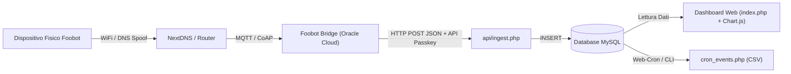

# NewFoobot — Piattaforma Web & Dashboard di Monitoraggio Qualità dell'Aria

> **Versione:** 1.0.0 (Release Ufficiale)  
> **Sviluppatore:** Barbara Lerici  
> **Sito Ufficiale Sviluppatore:** [barbaralerici.net](https://barbaralerici.net)  
> **Portale Ufficiale del Progetto:** [newfoobot-restart.barbaralerici.net](https://newfoobot-restart.barbaralerici.net)  
> **Licenza:** Open Source (MIT)

---

## 📌 1. A cosa serve questo progetto?

**NewFoobot** e la soluzione open-source completa progettata per **riportare in vita e rendere autonomi i dispositivi fisici Foobot (Airboxlab)** a seguito della definitiva dismissione dei server cloud e dell'applicazione mobile ufficiale del produttore avvenuta nel corso del 2026.

I dispositivi Foobot integrano una componentistica hardware di grado professionale:
- Sensore ottico di particolato fine ad alta sensibilita **PM2.5** (Sharp);
- Sensore a semiconduttore ad ossidi metallici (MOS MiCS) per i **Composti Organici Volatili (VOC)**;
- Sensore di precisione calibrato in fabbrica per **Temperatura** e **Umidita Relativa** (Sensirion SHT21);
- Algoritmo firmware interno per la stima dell'anidride carbonica equivalente (**eCO2**) e dell'indice globale di inquinamento (**GPI**).

A seguito dello spegnimento dei server cloud AWS proprietari, questi eccellenti sensori erano destinati a diventare rifiuti elettronici (*e-waste*). La piattaforma web NewFoobot (sviluppata in PHP nativo, MySQL e CSS puro indipendente) costituisce il **cuore software di ricezione, memorizzazione, analisi statistica e visualizzazione in tempo reale** di tutta la telemetria indoor, garantendo la totale sovranita e riservatezza dei dati sul proprio hosting personale (es. cPanel, Netsons o qualsiasi server Linux LAMP/LEMP).

---

## 🛠️ 2. Tecnologie e Componenti Utilizzati

La piattaforma e stata sviluppata secondo i principi di **massima indipendenza, efficienza, sicurezza e assenza di dipendenze esterne**:

| Componente | Tecnologia | Scopo e Motivazione |
| :--- | :--- | :--- |
| **Backend** | PHP 7.4 / 8.0 / 8.1 / 8.2 / 8.3 | Elaborazione server-side nativa veloce, portabile su qualsiasi hosting condiviso o dedicato senza moduli speciali. |
| **Database** | MySQL 5.7+ / MariaDB 10.3+ con PDO | Archiviazione relazionale ottimizzata con indici temporali per query veloci su decine di migliaia di rilevazioni. |
| **Frontend Styling** | **CSS Puro 100% Autonomo** (`style.css`) | Nessuna dipendenza da framework esterni (Tailwind CDN dismesso). Pieno controllo grafico, zero chiamate esterne e supporto nativo Dark/Light Mode. |
| **Grafici & Visualizzazione** | Chart.js v4.4.1 & Annotation Plugin (Locali) | Rendering client-side su Canvas HTML5. I file `.min.js` sono inclusi localmente nel progetto, garantendo funzionamento anche offline o su reti isolate. |
| **Sicurezza** | Bcrypt (`password_hash`), CSRF Token, Rate Limiting, Geo-IP | Protezione completa contro attacchi brute-force, CSRF, tentativi di injection e accessi non autorizzati. |
| **Internazionalizzazione** | Motore i18n basato su dizionari JSON | Supporto nativo bilingue Italiano (IT) e Inglese (EN) istantaneo. |
| **Sistema di Backup** | Web-Cron e CLI PHP nativi | Esportazione in formato CSV universale sia dei dati ambientali che degli eventi di rete, con rotazione automatica fino a 30 copie storiche. |

---

## 📂 3. Struttura del Progetto e Spiegazione Dettagliata dei File

Di seguito viene descritto il ruolo e il funzionamento di ciascun file presente nel pacchetto software.

```
/
├── api/
│   ├── device_status.php      # Endpoint JSON di stato in tempo reale per monitoraggio
│   ├── get_data.php           # API per estrazione dati storici usata dalla Dashboard
│   └── ingest.php             # Endpoint REST per ricezione telemetrie dal Foobot Bridge
├── assets/
│   ├── css/
│   │   └── style.css          # Foglio di stile CSS puro (Light & Dark theme, responsive)
│   └── js/
│       ├── dashboard.js       # Logica client-side interattiva: grafici, filtri e modali
│       ├── theme.js           # Gestione tema Chiaro/Scuro e persistenza in localStorage
│       └── external/
│           ├── chart.min.js                  # Libreria Chart.js v4.4.1 servita localmente
│           └── chartjs-plugin-annotation.min.js # Plugin annotazioni per soglie grafiche
├── backups/                   # Directory protetta per archiviazione dei backup CSV
│   └── .htaccess              # Protezione accesso diretto Web (Deny from all)
├── languages/
│   ├── en.json                # Dizionario di traduzione lingua Inglese
│   └── it.json                # Dizionario di traduzione lingua Italiana
├── auth.php                   # Core di autenticazione, sessioni, rate limiting e ruoli
├── CHANGELOG.md               # Registro storico di tutte le versioni e modifiche
├── check_db.php               # Script diagnostico indipendente per controllo integrita DB
├── config.php                 # File di configurazione generato (credenziali DB e passkey)
├── config.sample.php          # Template di configurazione per installazioni manuali
├── cron_events.php            # Script di esecuzione backup periodico (Web-Cron o cPanel CLI)
├── forgot_password.php        # Richiesta di recupero password smarrita via email
├── i18n.php                   # Funzioni di internazionalizzazione e helper traduzione __()
├── index.php                  # Dashboard principale di monitoraggio della qualita dell'aria
├── install.php                # Installatore guidato in 2 passaggi con inizializzazione DB
├── login.php                  # Pagina di accesso sicuro con protezione anti-brute force e CSRF
├── logout.php                 # Chiusura sessione utente e distruzione cookie
├── logs.php                   # Registro eventi di connessione e console diagnostica live
├── nav.php                    # Barra di navigazione condivisa con selettori lingua e tema
├── README.md                  # Questo documento tecnico di riferimento
├── reset_password.php         # Reimpostazione password tramite token crittografico monouso
├── schema.sql                 # Struttura DDL MySQL delle tabelle del database
└── settings.php               # Pannello di amministrazione, parametri, utenti e manutenzione
```

---

### 📄 Dettaglio dei Singoli File

#### Radice del Progetto

1. **`index.php` (Dashboard Principale)**:
   - Costituisce l'interfaccia principale per gli utenti autenticati (sia Amministratori che Visualizzatori).
   - Mostra le tessere di sintesi (KPI) dell'ultima rilevazione: GPI, VOC, PM2.5, eCO2, Temperatura e Umidita, ciascuna con il badge del livello qualitativo (`Super`, `Buono`, `Medio`, `Cattivo`).
   - Contiene il grafico interattivo storico multi-asse basato su Canvas e controllato da `dashboard.js`.
   - Include il menu a schede orizzontali per navigare tra i singoli sensori e il modale informativo con le spiegazioni scientifiche e le soglie ufficiali del firmware Foobot.
   - Fornisce i comandi per il cambio di range temporale (minuti, ore, giorni, ecc.) e per scorrere avanti e indietro nel tempo.

2. **`settings.php` (Pannello Impostazioni e Amministrazione)**:
   - Riservato rigorosamente al ruolo **Amministratore (`admin`)**; reindirizza gli utenti standard alla Dashboard.
   - Comprende 6 schede funzionali:
     - **Profilo e Password**: aggiornamento email e password dell'amministratore connesso;
     - **Parametri Rete & Passkey API**: configurazione dell'IP del Broker Oracle Cloud, del server NextDNS e della chiave di autenticazione per l'ingestione dati;
     - **Sicurezza Avanzata**: gestione Whitelist IP (con pulsante rapido di rilevamento del proprio IP), filtro geografico Geo-IP per nazione e blocco invii non provenienti dal broker autorizzato;
     - **Pianificazione Backup**: impostazione frequenza ed orario del Web-Cron automatico;
     - **Gestione File di Backup**: tabella con elenco file presenti su server, download protetto e **pulsante cestino** per la rimozione del singolo file;
     - **Gestione Utenti**: modulo per la creazione di nuovi account, elenco utenti con identificazione e protezione dell'**Admin Primario**, pulsante di modifica con modale interattivo (username, email, ruolo, cambio password) e pulsante di cancellazione;
     - **Manutenzione Database**: cancellazione parziale o totale dei dati storici con digitazione obbligatoria della stringa di sicurezza `CONFERMA`.

3. **`logs.php` (Registro Eventi e Console Diagnostica)**:
   - Accessibile a tutti gli utenti per consultare il registro degli eventi di rete, le disconnessioni e i blackout del router (>12 minuti tra telemetrie consecutive).
   - Per gli **amministratori**, include la **Console Diagnostica Live**: riceve e visualizza in tempo reale i log grezzi inviati dal Foobot Bridge con auto-aggiornamento continuo ogni 60 secondi e pulsante di pulizia rapida.

4. **`login.php` & `logout.php`**:
   - Gestione autenticazione con protezione da attacchi di forza bruta: dopo 10 tentativi consecutivi errati, l'IP viene bloccato per 15 minuti tramite la tabella `foobot_login_attempts`.
   - Accesso diretto con nome utente o email e password, protetto da token CSRF e controllo opzionale su Whitelist IP o restrizione geografica.

5. **`forgot_password.php` & `reset_password.php`**:
   - Flusso sicuro per il recupero delle credenziali smarrite. Genera un token crittografico SHA-256 memorizzato nella tabella `foobot_password_resets` valido per 30 minuti e invia il link via email tramite `mail()` di PHP.

6. **`install.php`**:
   - Procedura guidata di configurazione iniziale in 2 passaggi. Verifica la connessione a MySQL, crea automaticamente le tabelle leggendo `schema.sql`, registra il primo account Amministratore (Admin Primario) e compila il file `config.php`.

7. **`check_db.php`**:
   - Strumento di diagnostica rapida per verificare lo stato del database, la presenza delle tabelle, il numero di righe registrate e la coerenza dei dati.

8. **`cron_events.php`**:
   - Motore di backup universale eseguibile sia via browser (richiamato internamente da `settings.php` o tramite richiesta HTTP protetta da parametro `?key=PASSKEY`) sia via linea di comando / cPanel Cron Job (`php -q /percorso/cron_events.php`).
   - Genera due file CSV: `foobot_backup_YYYY-MM-DD_HH-ii-ss.csv` per i dati dei sensori e `foobot_connection_logs_YYYY-MM-DD_HH-ii-ss.csv` per gli eventi di rete. Mantiene sempre i 30 file piu recenti rimuovendo automaticamente i piu obsoleti.

9. **`auth.php`**:
   - Modulo centrale per la sicurezza: avvia le sessioni PHP sicure con flag `HttpOnly` e `SameSite=Lax`, controlla l'identita dell'utente (`require_authenticated_user()`), verifica i permessi di amministrazione (`require_admin_role()`), genera e controlla i token CSRF (`verify_csrf_token()`) e gestisce il rate limiting.

10. **`i18n.php`**:
    - Gestisce la lingua attiva leggendo il parametro `$_GET['lang']` o il cookie di sessione. Carica il file JSON corrispondente (`it.json` o `en.json`) e mette a disposizione la funzione helper globale `__('chiave', 'testo_default')`.

11. **`nav.php`**:
    - Componente HTML/PHP incluso in tutte le pagine visibili. Mostra il logo, il titolo della piattaforma, i link di navigazione condizionati dal ruolo dell'utente, il toggle per il tema Chiaro/Scuro, il selettore di lingua IT/EN e il menu a tendina dell'utente con pulsante di disconnessione.

12. **`config.php` & `config.sample.php`**:
    - Contiene le costanti fondamentali: `DB_HOST`, `DB_NAME`, `DB_USER`, `DB_PASS`, `DB_CHARSET`, `API_SECRET_KEY`, `ORACLE_BROKER_IP`, `NEXTDNS_SERVER_IP` e la funzione `get_db_connection()`.

13. **`schema.sql`**:
    - File DDL con le istruzioni SQL necessarie per creare le tabelle:
      - `foobot_readings`: memorizza timestamp, GPI, VOC, PM2.5, eCO2, Temperatura, Umidita e metriche grezze;
      - `foobot_users`: tabella utenti con username, password hashata Bcrypt, email, ruolo (`admin`/`user`) e date di creazione/aggiornamento;
      - `foobot_settings`: archivio chiave-valore per le preferenze di sistema (orari di backup, whitelist, filtri geografici, ecc.);
      - `foobot_connection_logs`: registro degli eventi di rete, disconnessioni e durata delle interruzioni;
      - `foobot_login_attempts`: contatore per la protezione anti-brute force con blocco temporaneo;
      - `foobot_password_resets`: token monouso per il recupero password.

---

#### Cartella `api/`

- **`api/ingest.php`**:
  - Riceve le chiamate POST in formato JSON inviate ogni ~5 minuti dal Bridge.
  - Verifica l'autenticita della richiesta tramite header `X-API-Key` o parametro URL `key`.
  - Se abilitato nelle impostazioni, verifica che l'IP mittente coincida con quello del broker Oracle configurato.
  - Calcola la differenza temporale con l'ultima lettura: se sono trascorsi piu di 12 minuti, registra automaticamente un evento di blackout/caduta linea nella tabella `foobot_connection_logs`.
  - Inserisce la rilevazione nel database MySQL e restituisce una risposta JSON standard `{"success": true}`.

- **`api/get_data.php`**:
  - Endpoint JSON interrogato da `dashboard.js` per richiedere le letture storiche.
  - Accetta parametri di range temporale (es. `range=24h`, `range=7d`, `range=custom&days=15`) e l'offset di scorrimento temporale (`offset=1`).
  - Ottimizza il carico aggregando i dati se l'intervallo temporale e molto esteso per non sovraccaricare il browser del client.

- **`api/device_status.php`**:
  - Restituisce lo stato attuale del sensore in formato JSON: ultima rilevazione, scostamento temporale, stato online/offline e statistiche giornaliere.
  - Blindato: accessibile solo agli amministratori autenticati in sessione o con passkey segreta.

---

#### Cartella `assets/`

- **`assets/css/style.css`**:
  - Motore di stile completo in **CSS puro** privo di dipendenze esterne.
  - Implementa un sistema di variabili CSS per il supporto istantaneo del Tema Chiaro e del Tema Scuro (`html[data-theme="dark"]`).
  - Gestisce l'intera griglia della dashboard, le schede dei sensori, le barre di avanzamento, i badge qualitativi, i modali interattivi e i pulsanti di azione (`.btn-action`, `.btn-secondary`, `.btn-trash`, `.btn-edit`).

- **`assets/js/dashboard.js`**:
  - Gestisce l'intero ciclo di vita della Dashboard interattiva.
  - Inizializza l'istanza di Chart.js configurando le scale ad auto-estensione dinamica per evitare l'appiattimento delle curve in caso di picchi improvvisi di VOC o PM2.5.
  - Memorizza in sessione (`userHiddenDatasets`) lo stato dei pulsanti della legenda: le curve disattivate dall'utente rimangono nascoste anche al cambio di intervallo temporale (minuti, ore, giorni).
  - Implementa la navigazione cronologica avanti/indietro e gestisce l'apertura e il popolamento del modale informativo delle soglie.

- **`assets/js/theme.js`**:
  - Script leggero eseguito nell'`<head>` per evitare sfarfallii visivi (*FOUC*). Rileva la preferenza del tema salvata in `localStorage` o nel sistema operativo e applica l'attributo `data-theme="dark"` al tag `<html>`.

- **`assets/js/external/`**:
  - Contiene le versioni minificate e verificate di **Chart.js v4.4.1** e del plugin annotazioni, garantendo la totale assenza di richieste esterne a CDN esterne.

---

#### Cartella `languages/`

- **Dizionari predefiniti (`it.json`, `en.json`, `de.json`, `es.json`, `fr.json`)**:
  - Contengono tutte le stringhe di interfaccia della piattaforma, dai messaggi di errore e successo alle etichette dei pulsanti, fino alle spiegazioni scientifiche delle soglie di ciascun inquinante.
- **File modello `template.json`**:
  - Contiene l'intero albero delle chiavi vuote del sistema, pronto per creare una nuova traduzione.
- **Procedura per aggiungere una nuova lingua**:
  1. Accedere via FTP o File Manager alla cartella `languages/`.
  2. Duplicare `template.json` (oppure `en.json` / `it.json`) e rinominarlo con il codice standard ISO a 2 lettere minuscole della lingua (es. `pt.json` per il portoghese, `nl.json` per l'olandese, `pl.json` per il polacco, `el.json` per il greco).
  3. Modificare i testi a destra dei due punti, conservando invariati i segnaposto dinamici tra graffe (es. `{user}`, `{time}`) ed eventuali tag HTML (`<strong>`, `<code>`).
  4. Caricare il file sul server: il modulo `i18n.php` scansiona dinamicamente la cartella e rende la nuova lingua subito disponibile nel selettore e nei profili utente, con fallback automatico in inglese/italiano per eventuali chiavi mancanti.

---

#### Cartella `backups/`

- Cartella dedicata allo stoccaggio sicuro dei backup generati in formato CSV.
- Contiene un file `.htaccess` con direttiva `Deny from all` che impedisce a chiunque di accedere direttamente ai file CSV tramite URL pubblico, proteggendo la riservatezza delle letture.

---

## 🔄 4. Flusso Architetturale dei Dati



1. **Rilevazione**: Il dispositivo Foobot analizza costantemente l'aria e tenta di trasmettere le metriche ai server originali.
2. **Reindirizzamento**: Grazie alle regole di spoofing configurate su NextDNS o sul router di casa, il traffico viene convogliato verso il Bridge personale ospitato su Oracle Cloud.
3. **Ingestione**: Il bridge inoltra le telemetrie tramite chiamata HTTP POST autenticata all'endpoint `api/ingest.php` dell'hosting.
4. **Archiviazione**: Lo script PHP calcola l'indice GPI, controlla la presenza di blackout di rete e salva il dato nel database MySQL.
5. **Visualizzazione**: La dashboard client-side visualizza lo stato corrente e disegna il grafico dinamico interrogando `api/get_data.php`.
6. **Conservazione**: A intervalli regolari, il sistema genera un archivio CSV compresso con rotazione automatica fino a 30 copie storiche.

---

## 🔒 5. Modello di Sicurezza e Permessi di Accesso

La piattaforma adotta una matrice di sicurezza gerarchica a tre livelli:

1. **Amministratore Primario (`id = 1`)**:
   - Creato durante l'installazione guidata (`install.php`).
   - Ha accesso completo a ogni configurazione, profilo, parametro di rete, backup e manutenzione del database.
   - **Protetto**: non puo essere cancellato ne degradato al ruolo di visualizzatore, prevenendo l'estromissione accidentale dal sistema.

2. **Amministratori Secondari (`role = 'admin'`)**:
   - Creati successivamente dal pannello utenti.
   - Hanno accesso completo alle impostazioni e alla console diagnostica, ma possono essere modificati o revocati dall'amministratore primario.

3. **Visualizzatori Standard (`role = 'user'`)**:
   - Account destinati alla consultazione domestica o di collaboratori.
   - Possono visualizzare esclusivamente la **Dashboard** (`index.php`) e il **Registro Eventi** (`logs.php`).
   - Il menu Impostazioni (`settings.php`) e rigorosamente nascosto e protetto a livello di backend con rifiuto 403 Forbidden.
   - La **Console Diagnostica** di debug con i log grezzi del bridge e completamente oscurata.

---

## 🚀 6. Guida Rapida all'Installazione su cPanel

1. **Creazione Database**:
   - Accedi al cPanel del tuo hosting (es. Netsons) e apri **MySQL Database Wizard**.
   - Crea un nuovo database (es. `utente_newfoobot`), un utente MySQL dedicato e assegna tutti i privilegi.
2. **Caricamento File**:
   - Carica l'intero contenuto di questa cartella nella directory pubblica desiderata (es. `public_html/` o `public_html/foobot/`).
3. **Configurazione Guidata**:
   - Apri il browser all'indirizzo del tuo dominio (es. `https://tuodominio.it/`).
   - Verrai reindirizzato automaticamente all'installatore guidato `install.php`.
   - Inserisci le credenziali del database MySQL create al punto 1.
   - Crea il tuo account Amministratore Primario e inserisci la tua Passkey API.
4. **Automazione Backup Notturno su cPanel**:
   - In cPanel, apri la sezione **Cron Jobs (Operazioni pianificate)**.
   - Imposta l'esecuzione una volta al giorno (es. alle ore 02:00 di notte) con la riga di comando:
     ```bash
     php -q /home/TUO_UTENTE_CPANEL/public_html/cron_events.php
     ```

---

## 👤 7. Autore & Crediti

* **Ideazione, Architettura e Sviluppo Software:** **Barbara Lerici**
* **Sito Web Personale:** [barbaralerici.net](https://barbaralerici.net)
* **Portale Ufficiale del Progetto:** [newfoobot-restart.barbaralerici.net](https://newfoobot-restart.barbaralerici.net)
* **Licenza:** Open Source (Licenza MIT)
